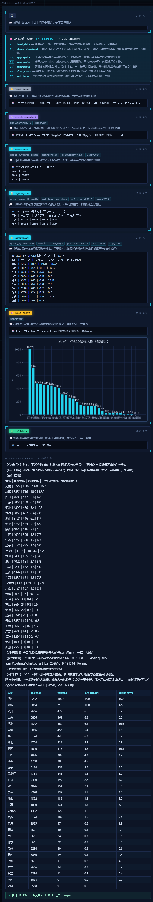

# Air Quality Analysis Agent

**Natural language in, tool-call chains out.** A ReAct agent that turns plain-language questions into executable analysis pipelines over **137,250 real daily monitoring records** (375 Chinese cities, full-year 2024) — with GB 3095-2012 compliance judgment, streaming execution traces, and zero-dependency web console.

[](https://www.python.org/)
[](LICENSE)
[](web.py)
[](tests/)



## What it does

Ask a question in plain language — *"Which 5 cities had the highest PM2.5 in 2024, and what were the cleanest 5?"* — and the agent:

1. **Plans** a tool-call chain for that specific question (LLM function calling, or the built-in local rule planner as offline fallback);
2. **Executes** it step by step on the real dataset (chunked loading → cleaning → aggregation → standard-based judgment);
3. **Streams** every Thought / Action / Observation event to the browser while it runs;
4. **Delivers** a structured conclusion, data tables, and charts — with a validation pass on the numbers.

The LLM only decomposes tasks. Every number comes from local computation over the dataset — the model never touches the data.

## Features

- **Per-question tool-chain planning** — function-calling style: the LLM composes any of the 10 tools per question, so phrasing is free-form. No fixed intent table to match against.
- **Dual-mode planner with graceful fallback** — if the LLM times out, returns non-JSON, or hallucinates an unknown tool, the local rule planner takes over automatically. Fully functional with no API key and no network.
- **10 analysis tools** — grouped aggregation (including north/south group slicing), monthly trends, seasonal exceedance, MAD 3σ anomaly detection, inter-city Pearson correlation, pollution-source proxy analysis, national-standard lookup, charting, and result validation.
- **National-standard judgment** — GB 3095-2012 (Grade II) for the six pollutants, HJ 633-2012 for AQI. Pollutants without an annual limit are labeled as such instead of being silently misjudged.
- **Multi-part questions** — each sub-question becomes an independent result block; nothing gets overwritten by the last step. Bidirectional asks ("highest *and* lowest 5 cities") return both rankings.
- **Group slicing** — "the 3 worst provinces in the north and the south, each" returns per-region TOP-N slices directly, no manual regrouping from a 31-province table.
- **Multi-turn memory** — follow-ups like "what about Shanghai?" inherit context (year, pollutant) and switch scope correctly. Sessions are isolated per browser tab.
- **Honest refusals** — weather, foreign regions, and chitchat are explicitly declined with a note on what the agent *can* analyze, instead of being force-fitted to air-quality data.
- **Streaming web console** — SSE push with monotonic-clock throttling, plan-card preview, live ReAct trace, inline tables and charts, dark telemetry theme. Built on the Python standard library (`ThreadingHTTPServer`) — no Flask, no FastAPI.
- **Concurrent by design** — the dataset is loaded once and read-only; each request gets its own agent instance. Measured: 3 concurrent questions in 14 s vs 36 s serial.
- **Redundant-step pruning** — LLM plans are deduplicated before execution (adjacent repeats, identical recomputations), so occasional over-planning costs nothing.
- **Regression suites** — 4 test scripts covering the new capabilities, rule-mode coverage, concurrency, and a 20-question generalization audit in both planner modes.

## Quick start

```bash
pip install -r requirements.txt   # pandas + matplotlib only

# Web console (recommended) — opens http://127.0.0.1:8611
python web.py
python web.py --port 8080 --interval 1.5   # custom port / stream pacing

# Command line
python run.py
python run.py "Which city had the worst PM2.5 pollution in 2024?"
```

Then ask anything, for example:

- `Which 5 cities had the highest PM2.5 annual mean in 2024, and which 5 the lowest?`
- `Is the PM2.5 pollution in Beijing and Shijiazhuang synchronized?`
- `Where does Beijing's PM2.5 pollution mainly come from?`
- `The 3 provinces with the most PM2.5 exceedance days in the north and in the south, each`
- `Which season has the worst ozone pollution?`
- `Are there anomaly jumps in Beijing's O3 during 2024?`
- `How many cities met the Grade II annual PM2.5 standard in 2024?`

CLI extras: `help`, `board` (task dashboard), `mode pro|simple` (output template), `quit`.

## How it works

```
 user question
      │
      ▼
 ┌─────────────┐   LLM available?   ┌──────────────┐
 │   planner   │─── yes ───────────▶│  LLM plans   │  function-calling style,
 │  (router)   │                    │  the chain   │  per-question tool chain
 └─────────────┘                    └──────────────┘
      │ no (timeout / bad JSON / unknown tool)
      ▼
 ┌──────────────┐
 │ local rules  │  intent + slots → same step structure
 └──────────────┘
      │
      ▼
 TaskPlan(steps = [Step(tool, args, thought), ...])
      │
      ▼
 ReAct engine ── per step: Thought → Action → Observation ──▶ event stream
      │                                                        │
      │  10 tools over chunked dataframe                       ▼
      ▼                                              SSE (≥1s pacing) → browser
 tables · charts · judgment · validation             plan card · step cards · conclusion
```

Every tool is a pure function over the dataframe; results accumulate as independent blocks so multi-part questions render side by side. `validate` re-checks share sums, ranking monotonicity, and sample sizes before the conclusion is shown.

## Tools

| Tool | Purpose | Key args |
|---|---|---|
| `load_data` | Chunked read + clean of the dataset | — |
| `aggregate` | Grouped aggregation | `group_by=city/province/season/north_south`, `metric=mean/exceed_days`, `pollutant`, `cities`, `provinces`, `year`, `top_n` (500 for full ranking), `order=asc/desc`, `split_by=north_south` (per-region TOP-N) |
| `trend` | Monthly concentration curves | `cities`, `pollutant`, `year` |
| `season_exceed` | Single city × season exceedance | `city`, `season`, `pollutant`, `year` |
| `anomaly` | MAD 3σ jump detection | `city`, `pollutant`, `year` |
| `city_correlation` | Two-city daily Pearson r (regional transport / synchronicity) | `cities`, `pollutant`, `year` |
| `pollution_source` | Source proxy analysis (dust / traffic & combustion / heating / secondary formation) | `city`, `pollutant`, `year` |
| `check_standard` | Limit lookup (GB 3095-2012 / HJ 633-2012) | `pollutant`, `kind` |
| `plot_chart` | auto line / bar / pie | `chart` |
| `validate` | Sanity checks on every result block | — |

## Data

- **Source**: CN-AIR — public daily air-quality monitoring data from the China National Environmental Monitoring Centre (MIT-licensed), 375 cities, full-year 2024, six pollutants + AQI, **137,250 daily records**.
- **Pipeline**: hourly wide tables → tidy long table via `scripts/prepare_data.py` (chunked conversion); reload with chunked readers — nothing is fully materialized twice.
- **Regenerate**:

```bash
python scripts/fetch_data.py --year 2024
python scripts/prepare_data.py --raw-dir <unpacked-dir> --year 2024
```

Daily-value conventions are documented in `data/DATASET.md`.

## Standards

| Pollutant | Metric | Grade II limit |
|---|---|---|
| PM2.5 | 24 h / annual | 75 / 35 μg/m³ |
| PM10 | 24 h / annual | 150 / 70 μg/m³ |
| SO₂ | 24 h / annual | 150 / 60 μg/m³ |
| NO₂ | 24 h / annual | 80 / 40 μg/m³ |
| O₃ | 8 h rolling max | 160 μg/m³ |
| CO | 24 h | 4 mg/m³ |

AQI follows HJ 633-2012 (>100 = exceedance day).

## Testing

```bash
python tests/smoke_new_caps.py          # new capabilities + pruning + multi-part regression (10 assertions)
python tests/rule_mode_audit.py         # 20-question audit, LLM forcibly disabled → 20/20 semantically complete
python tests/generalization_audit.py    # same 20 questions, LLM mode, novel phrasings
python tests/web_concurrency_check.py   # 3 concurrent SSE streams + session isolation (14 s vs 36 s serial)
```

Audit logs are written to `outputs/logs/`.

## Optional: LLM task planning

Works out of the box with the local rule planner. To enable LLM-planned chains, point it at any OpenAI-compatible endpoint:

```bash
# .env in the project root (auto-loaded at startup)
AQ_LLM_BASE_URL=https://api.openai.com/v1
AQ_LLM_API_KEY=sk-...
AQ_LLM_MODEL=gpt-4o-mini
```

The web console header shows the active planner (LLM / local rules). Failure modes — timeout, non-JSON, unknown tool, out-of-range args — all fall back to the rule planner automatically.

## Project structure

```
air-quality-agent/
├── run.py                     # CLI entry
├── web.py                     # Web console entry (stdlib HTTP + SSE, no framework)
├── requirements.txt
├── aq_agent/                  # Core package
│   ├── config.py              # GB 3095-2012 limits, paths, season constants
│   ├── geo.py                 # City → province map (375 cities)
│   ├── data_layer.py          # Chunked read + cleaning
│   ├── analysis.py            # Aggregation, standard judgment, anomaly, validation
│   ├── planner.py             # Question → task plan (LLM + local rules)
│   ├── react_agent.py         # ReAct engine + the 10 tools
│   ├── memory.py              # Multi-turn memory + task dashboard
│   ├── charts.py              # matplotlib line/bar/pie (Chinese font auto-setup)
│   ├── report.py              # Structured text + HTML reports
│   └── cli.py                 # Interactive CLI
├── scripts/                   # Data fetch / prepare
├── data/processed/            # Analysis dataset (137,250 rows)
└── tests/                     # 4 regression / audit suites
```

## License

[MIT](LICENSE). Dataset © China National Environmental Monitoring Centre (CN-AIR, MIT), used for research and learning.

---

## 中文简介

空气质量时序分析 Agent：自然语言提问 → **LLM 针对每个问题现生成工具调用链**（function calling 风格，任意问法；无 Key 无网时自动回退本地规则规划器）→ ReAct 引擎按链逐步调度 → 本地真实数据集分片读取清洗 → 聚合统计 → **GB 3095-2012 国标超标研判** → 文本结论 + 可视化图表 + HTML 报告，网页版 SSE 流式展示全过程。

- **数据**：CN-AIR 公开监测数据，375 城 × 2024 全年 × 137,250 条日记录（六项污染物 + AQI）；
- **能力**：10 个分析工具（分组切片/月度趋势/季节超标/MAD 3σ 异常/城市间相关性/来源代理分析/国标查询/绘图/校验）、多部分问题分块作答、多轮记忆按会话隔离、域外问题诚实拒答；
- **运行**：`pip install -r requirements.txt` 后 `python web.py`（默认 8611 端口）或 `python run.py`；
- **测试**：`tests/` 下 4 个回归/审计脚本，规则模式与 LLM 模式双覆盖。
